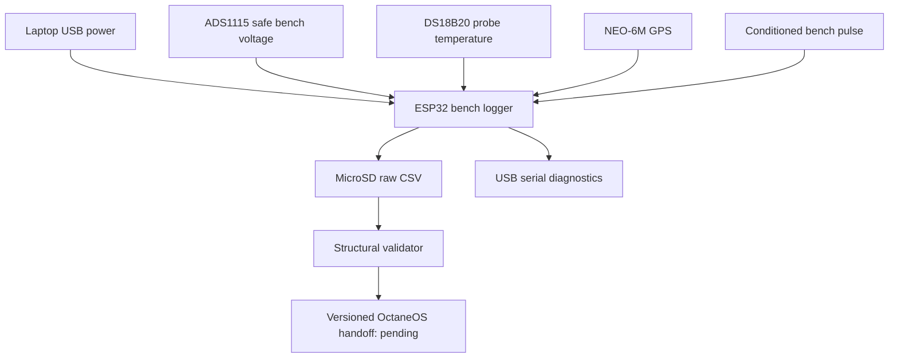

# SAN-V1 — Automotive Data Acquisition

**Asphalt Sovereign | Recovered USB-bench firmware | Consolidated 12 November 2026**

## 1. Problem

Engineering analysis needs synchronized raw measurements with source, time and health information. A low-cost logger must first prove its measurement and storage chain before it can supply trustworthy vehicle data.

## 2. Automotive relevance

Automotive signals have electrical, timing and calibration requirements that a hobby board cannot satisfy by direct connection. SAN-V1 begins with an isolated, USB-powered bench acquisition chain and records the evidence needed for a later reviewed vehicle interface.

## 3. Engineering requirements

| Requirement | Target or status |
|---|---|
| Periodic CSV logging | 100 ms design period; 10 Hz target, not measured here |
| Explicit missing channels | Blank unavailable values and health flags |
| Timing and provenance | Sequence, uptime, device/session identity; UTC only when available |
| Storage | New SD session file, periodic flush, error flags |
| Bench gate | 10 cold boots, 30-minute log and abrupt-power recovery, not yet evidenced |
| Electrical scope | USB power; ADC input within its 3.3 V-powered rails; conditioned 0–3.3 V pulse only |

## 4. Selected architecture



## 5. Component selection

ESP32 provides the development and serial platform. ADS1115 adds external ADC channels; DS18B20 supplies a separately named probe temperature; NEO-6M can provide position/time/speed when a fix is available; MicroSD retains offline logs. These are bench choices, not a validated automotive-grade BOM. DS3231/LM2596/PC817 appeared in wider planning but are not implemented by the selected bench firmware and are not silently counted as working channels.

## 6. Implemented

Recovered original packages include a PlatformIO C++ logger, an Arduino IDE variant, bare-ESP32 USB test sketch, provisional pin map, health flags, CSV validator and blank physical run sheet. The founder's existing record supports firmware upload and USB serial checks. Integrated sensor/SD evidence has not been recovered.

## 7. Testing

Run the software validator characterization suite from this repository root:

```bash
python3 -m unittest discover -s tests -v
python3 firmware/platformio/tools/validate_csv.py data/samples/synthetic_bench.csv
```

The fixture is synthetic and covers one second of data. It is not a 30-minute acceptance log. [tests/README.md](tests/README.md) and [docs/verification-2026-11-12.md](docs/verification-2026-11-12.md) distinguish software checks from physical tests.

## 8. Actual results

Two original firmware packages were recovered, with file hashes preserved. Current validator results are reported in the dated verification record. No hardware was flashed, connected, calibrated or measured during consolidation. No 10 Hz physical rate, sensor accuracy, power-loss recovery, vehicle signal capture or integrated OctaneOS upload is claimed.

## 9. Limitations and known issues

- Bench firmware emits `san_csv_1.0`; the recovered workshop importer expects a different contract. See [docs/data-contract.md](docs/data-contract.md).
- The structural validator does not establish sensor accuracy, UTC validity or finite/physically plausible channel values. A passing file is not a physical-test pass.
- PlatformIO platform/core versions were not pinned in the original. Library ranges are declared below; exact build resolution and compilation remain pending.
- The earlier August manual refers to a 38-pin board; selected 19 August config states a classic 30-pin DevKit. Verify actual board and breakout markings before wiring.
- RPM pulses/revolution and all calibration gains remain bench assumptions. There is no direct ECU, injector or ignition interface.

## 10. Next engineering milestone

Confirm the actual module revisions and obtain an independently measured, repeatable USB-bench CSV. Complete the 10-boot, multimeter-reference, 30-minute continuity and power-loss checks with raw files and dated photos, then agree the software adapter contract.

## Build, installation and hardware

The host CSV validator uses only the Python standard library. Characterization was performed with Python 3.12. PlatformIO configuration is under [firmware/platformio/](firmware/platformio/); open that directory, not the repository root, as the project. Arduino setup instructions and the isolated USB test are under [firmware/arduino/](firmware/arduino/).

Required bench items: actual classic ESP32 DevKit, data-capable USB cable, 3.3 V-powered ADS1115 breakout, powered DS18B20 with 4.7 kΩ pull-up, identified NEO-6M breakout, compatible MicroSD module/card, breadboard, jumpers and multimeter. A 1 kΩ series resistor and 10 kΩ pull-down are specified for the optional generated pulse test. Breakout supply/level-shifter differences must be checked against the actual parts.

Declared library ranges: Adafruit ADS1X15 `^2.5.0`, OneWire `^2.3.8`, DallasTemperature `^4.0.4`, TinyGPSPlus `^1.1.0`. Original platform: `espressif32`, board `esp32dev`, Arduino framework; the platform/core is unpinned. These are declared ranges, not a claimed reproducible compiled toolchain. [hardware/README.md](hardware/README.md) records the boundary.

## Evidence and logs

The repository includes actual source and a synthetic host fixture. Physical wiring photos, serial captures and genuine SD logs remain pending and must be stored with a run ID and hashes. [logs/README.md](logs/README.md) defines the evidence record; no fabricated hardware screenshot is supplied.

Engineering portfolio: [Asphalt Sovereign](https://github.com/asphaltsovereign/automotive-engineering-portfolio).
